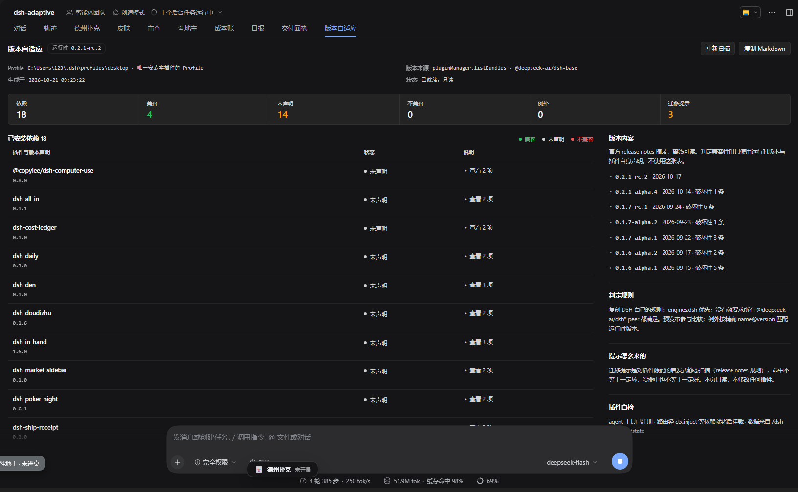

# dsh-adaptive · 版本自适应

自检当前 DSH 运行时版本，按 **DSH 自己的规则**扫描当前 Profile 里已装插件的版本兼容性，
再用官方 release notes 摘出的规则指出源码里仍在使用已变更接口的位置。只读，不联网，不改插件。


## 界面



实机截图（desktop Profile、运行时 `0.2.1-rc.2`、18 个依赖）：顶部是运行时版本与 Profile 来源，
中间一排六个状态计数，左边逐插件表格可展开看版本约束 / 未满足项 / 迁移提示，右边是版本内容快照、
判定规则说明与本插件自检。画面左下的「斗地主」、底部的「德州扑克」两张浮动卡片是别的插件的浮窗，
底部输入框是宿主自己的——它们都不是本插件的界面，只是同一屏里同时存在。

## 为什么需要它

DSH 从 `v0.1.7-rc.1` 起会在**插件安装和启动时检查版本兼容性**，`v0.2.1-alpha.4` 起明确
「第三方插件的版本兼容性优先按 `engines.dsh` 判断」。但实际装到机器上的第三方插件，
大多数根本没有声明 `engines.dsh`，也没有 `@deepseek-ai/dsh*` 的 peerDependencies——
DSH 不会拒绝它们，升级后也没有任何判据能提示风险。

本插件把这个判据显式摊开：谁声明了什么、当前运行时满不满足、哪些命中已授权的例外、
哪些还在调用已经被改名/弃用的接口。

## 它做三件事

1. **识别运行时版本**：优先读 `pluginManager.listBundles()` 里 installation 来源的
   `@deepseek-ai/dsh-base` 版本；读不到就解析 `@deepseek-ai/dsh-app-boot/package.json`
   （DSH 自己的 `getDshRuntimeVersion()` 就是取 app-boot 的版本）。
2. **定位 Profile**：宿主进程本身没有 `DSH_PROFILE_DIR`（那是 DSH 注入给 shell 调用的），
   所以按可信度依次尝试：插件配置 `profileDir` → 环境变量 `DSH_PROFILE_DIR` →
   `profileContext.packageManager.env` → `$DSH_HOME/profiles/*` 里**装了本插件**的那个目录
   （能被加载就说明本插件在那个 Profile 的 `node_modules` 里）。多个候选时取 `cordis.patch.yml`
   最近修改的一个，并在面板与报告里注明来源。
3. **兼容矩阵**：逐个读 Profile `package.json` 的依赖，解析真实包目录（`link:` 会落到真实路径），
   复刻 DSH 的判定规则给出状态：`兼容` / `不兼容` / `已授权例外` / `未声明版本约束` / `清单无法判定` / `读不到`。
4. **迁移提示**：对每个插件包源码做启发式静态扫描，命中 release notes 里
   `v0.1.6-alpha.1 → v0.2.1-rc.2` 的破坏性变更，给出 `文件:行号` 与建议。

## 判定规则（复刻 DSH，不自己发明）

来源：DSH `packages/boot/app-boot/src/plugin-compatibility.ts`。

- 清单有 `engines.dsh` 时**它单独决定**，peerDependencies 被忽略；
- 否则检查每一个 `@deepseek-ai/dsh` / `@deepseek-ai/dsh-*` 的 peer 范围，全部满足才算兼容；
- peer 写 `workspace:^` / `workspace:~` / `workspace:*` 时视为「当前运行时版本」；
- 预发布版本参与范围比较（`includePrerelease`），所以 `0.2.1-rc.2` 满足 `^0.2.0`；
- 例外按精确 `name@version` → 允许的运行时版本列表匹配，读自 `pluginManager.listVersionExemptions()`；
- `engines.dsh` 是空串时 DSH 判为**不满足**（`satisfies` 里先判 `trim() !== ''`），本插件照抄；
- 清单类型畸形（`engines.dsh` 不是字符串等）DSH 会抛错，本插件降级成「清单无法判定」并说明原因。

## 迁移提示规则表

| id | 自版本起 | 检测的旧接口 |
| --- | --- | --- |
| `agent-session-start` | 0.1.6-alpha.1 | `'agent/session-start'`（改为异步串行的 `agent/created`） |
| `session-sync-history` | 0.1.6-alpha.1 | `.snapshotEvents(`、`.eventAt(`、`.ownEvents(`（已弃用） |
| `ptc-package-rename` | 0.1.6-alpha.1 | `@deepseek-ai/dsh-ptc-*`、`dsh-ptc-*`（统一为 `ptc-runtime` 系列） |
| `workflow-executor-rename` | 0.1.6-alpha.1 | `'workflow-engine'`、`'workflow-executor'`（改为 `workflow-ptc`） |
| `deepseek-protocol` | 0.1.6-alpha.1 | `protocol: 'chat'/'completions'/'openai'`、`chat/completions` 根地址 |
| `settings-yaml` | 0.1.7-alpha.1 | `settings.yaml`（设置改存当前 Profile 的插件配置，只导入一次） |
| `legacy-agent-presets` | 0.1.7-alpha.1 | `.agent-presets/` 目录（预设改由插件组合包声明） |
| `workspace-read-text` | 0.1.7-alpha.1 | `.readText(`（工作区读取统一为 `readBytes`） |
| `append-plugin-record` | 0.1.7-alpha.1 | `appendPluginRecord(`（`plugin:` 记录只做尽力保留） |
| `spill-max-inline-bytes` | 0.1.7-alpha.2 | `maxInlineBytes`（改为 `maxInlineTokens`，单位是 token） |

**这是启发式扫描**：命中只说明源码里出现了该版本已变更或弃用的接口名，不等于一定坏
（比如插件自己写了个同名函数）；没命中也不等于一定好（动态调用、字符串拼接、压缩后的代码都可能漏）。
报告里也是这个措辞，没有把它包装成结论。规则表是 release notes 的快照，不是 release notes 的替代品。

## 安装

```powershell
# 让 DSH 自己把本目录当作 bundle 安装（不要手改 Profile 的 package.json / cordis.patch.yml）
# 在 DSH 里：插件管理页 → 安装 → 选择本地目录 D:\Projects\dsh-adaptive
```

安装后插件管理页会显示中文标题「版本自适应」与描述；图标与中英 locale 都在包里。

## 用法

- **面板**：会话视图右侧标签页「版本自适应」（`conversation.view`，order 55）。
  显示运行时版本与来源、Profile、依赖总数与各状态计数、逐插件表格（可展开看原因/未满足项/迁移提示/
  展示元数据建议）、版本内容折叠区；右上角「重新扫描」与「复制 Markdown」。
- **HTTP**（面板自己就用这些）：
  - `GET /dsh-adaptive/state`（`?refresh=1` 强制重扫）
  - `POST /dsh-adaptive/scan`
  - `GET /dsh-adaptive/report.md`
- **agent 工具** `adaptive_report`：参数 `refresh`、`format: json|markdown`、`includeHints`；
  返回结构化结果，`format=markdown` 时附带完整 Markdown 报告。

本机实测（`0.2.1-rc.2`，desktop Profile，18 个依赖）：兼容 4、未声明 14、不兼容 0、
迁移提示 3（`dsh-den`、`dsh-in-hand`、`@michengai/dsh-pua` 各一处仍在用 `snapshotEvents` / `eventAt` / `ownEvents`）。
同一份数据可在浏览器里打开 `GET /dsh-adaptive/state` 复核；面板页脚还会显示本插件自己的
agent 工具是否注册成功（`self.toolRegistered`），以及路由是靠哪种方式挂上的（`self.registration`：
`ctx.inject` 表示等宿主服务就绪后再注册；`ctx.effect` 是旧的一次性读取）。

## 边界

- **只读**：不安装、不卸载、不改插件状态、不写任何文件。
- **不联网**：版本内容是内置快照，带发布日期与 release 链接；DSH 发新版后需要更新快照。
- **只在本机 `0.2.1-rc.2` 上实测**，`engines.dsh` 因此声明为 `>=0.2.1-rc.2 <0.3.0`；
  面板与工具都软读服务（`webServer` / `tools` / `pluginManager` 缺失时插件仍能激活，只是少一个入口）。
- 兼容判定是复刻，不是引用 DSH 的内部函数；DSH 改判据时这里要跟着改（本插件自己也会因此被判为不兼容）。
- **注册顺序不靠运气**：DSH 不保证 `webServer` / `tools` 先于本插件激活。读一次 `ctx.get()` 读到
  `undefined` 就放弃，会让面板与工具**静默消失**（插件仍是 `active`）——0.1.1 起改用
  `ctx.inject(deps, cb)`，等依赖就绪再注册，`self.registration` 会写明实际用的是哪条路径。
- 迁移提示跳过 `node_modules`、`test`、`dist`、`tmp`、`_tmp` 等目录，只扫 `.js/.mjs/.cjs/.ts/.tsx/.jsx/.yml/.yaml`。

## 开发

```powershell
cd D:\Projects\dsh-adaptive
node --test test/*.test.mjs
```

- `src/semver.js`：最小 SemVer 子集（caret / tilde / 比较器 / 连字符 / `||` / 通配），
  语义对齐 `semver.satisfies(..., { includePrerelease: true })`，**零依赖**。
- `src/compat.js`：复刻 DSH 判据，纯函数。
- `src/rules.js`：release notes 规则表 + 启发式扫描。
- `src/scan.js`：只读扫描 Profile。
- `src/report.js`：Markdown 报告。
- `src/changelog.js`：版本内容快照。
- `index.js` / `client.js`：宿主半区与客户端半区。

## License

MIT
